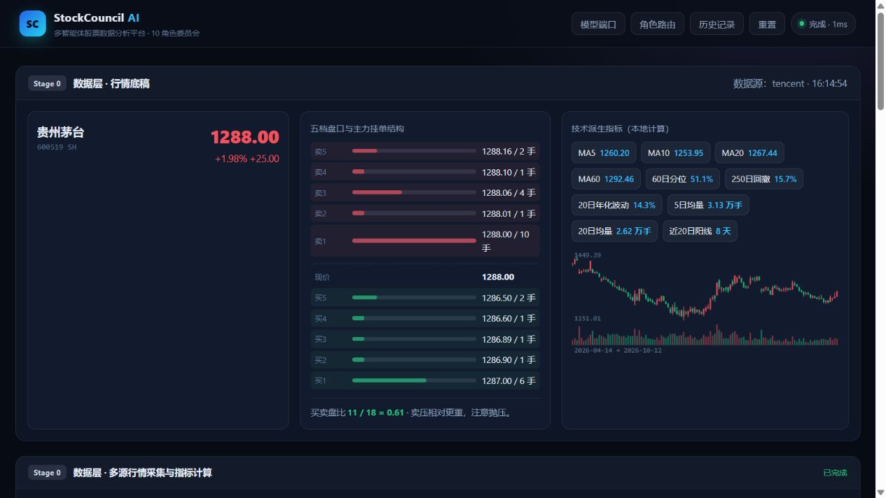
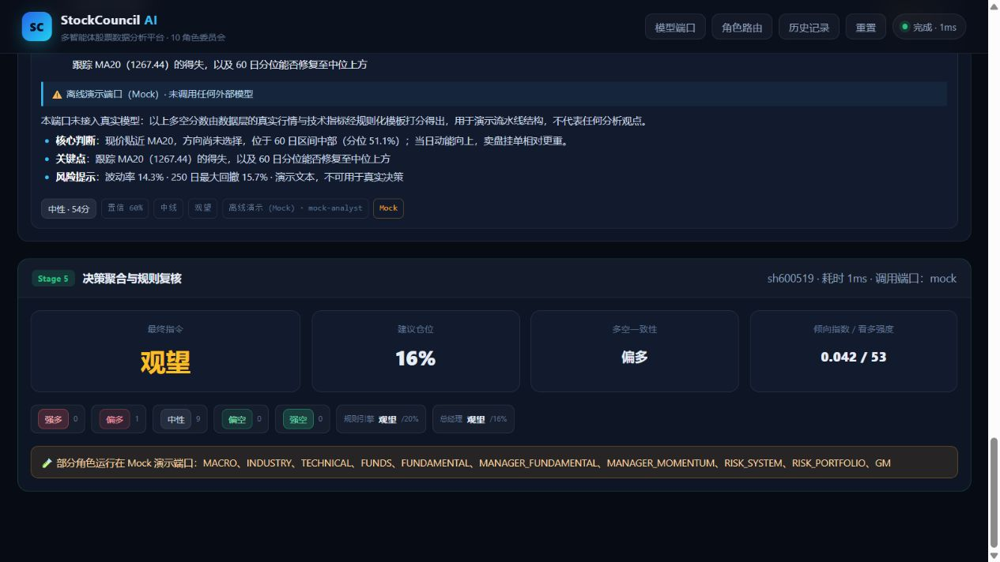

# StockCouncil · 多智能体股票数据分析平台

   

> 把一台「投资委员会」搬到浏览器里：**数据层多源取数 → 5 位分析师并行 → 2 位总监整合 → 2 位风控审核 → 总经理拍板 → 规则引擎复核**。
>
> 原理拆解见 [`docs/原理蒸馏.md`](docs/原理蒸馏.md)（从原版 AlphaCouncil「蒸馏」出的 8 条可复现机制 + 本平台的升级对照）。
> 仅用于个人学习，禁止用于商业用途！


---

## 效果预览

**Stage 0 · 数据层** —— 真实行情底稿：现价 / 五档盘口与主力挂单结构 / 技术派生指标 / 60 日 K 线，右上角标注数据源与时间戳。



**Stage 5 · 决策聚合** —— 最终指令 / 建议仓位 / 多空一致性 / 倾向指数 + 规则引擎复核与分歧告警。



> 截图是**未配置任何 API Key** 时 Mock 演示端口跑通全流程的结果：行情与指标取自真实数据，打分由规则化模板给出，仅用于展示流水线结构，不代表任何分析观点。

---

## 0. 30 秒跑起来

```powershell
cd StockCouncil
node server/index.mjs
```

然后打开 <http://127.0.0.1:8787> 。

- **零依赖**：只用 Node 内置模块，**不需要 `npm install`**（要求 Node ≥ 20）。
- **无 Key 也能跑**：未配置任何 API Key 时自动使用内置 **Mock 演示端口**，完整跑通四阶段流水线，方便先看效果。
- 行情数据是**免费的**（腾讯 / 新浪 / 东财三源），不需要注册任何数据服务。

---

## 1. 目录结构

```text
StockCouncil/
├─ server/                  后端（零依赖 Node ESM）
│  ├─ index.mjs             零依赖 HTTP 服务 + SSE 流式接口
│  ├─ config.mjs            .env 加载 / 端口注册表 / 就绪判定 / 角色路由 / 降级链
│  ├─ providers.mjs         统一 LLM 适配层（gemini 原生 / OpenAI 兼容 / mock）
│  ├─ market.mjs            三源行情（腾讯→新浪→东财）+ K线 + 本地派生指标
│  ├─ agents.mjs            10 个角色（人格 + systemPrompt + 结构化裁决契约）
│  ├─ orchestrator.mjs      四阶段流水线 + 结构化聚合引擎
│  └─ store.mjs             历史记录持久化（JSON，上限 100 条）
├─ web/                     前端（原生 JS/CSS，零依赖）
│  ├─ index.html
│  ├─ styles.css
│  └─ app.js
├─ docs/原理蒸馏.md         原理说明
├─ data/                    运行期生成：config.json（路由配置）/ history.json（历史）
├─ .env.example             环境变量样例（复制为 .env 后填写）
├─ start.cmd / start.ps1    一键启动脚本
└─ README.md
```

---

## 2. 模型端口（Provider）

平台内置 **8 个端口**，每个角色都可以独立绑定其中任意一个：

| 端口 id | 名称 | 协议 `kind` | 需要的环境变量 | 说明 |
|---|---|---|---|---|
| `gemini` | Google Gemini | `gemini` | `GEMINI_API_KEY` | 原生协议 + Google Search 联网 |
| `grok` | xAI Grok | `openai` | `XAI_API_KEY` | 实时舆情 / 反共识 |
| `openai` | OpenAI (GPT) | `openai` | `OPENAI_API_KEY` | 综合推理主力 |
| `chatgpt` | **ChatGPT（预留插槽）** | `openai` | `CHATGPT_API_KEY` + `CHATGPT_BASE_URL` | 预留待接入，见下 |
| `deepseek` | DeepSeek | `openai` | `DEEPSEEK_API_KEY` | 低成本量化推演 |
| `qwen` | 通义千问 | `openai` | `QWEN_API_KEY` | 中文财经语境 |
| `custom` | 自定义端点 | `openai` | `CUSTOM_API_KEY` + `CUSTOM_BASE_URL` | vLLM / Ollama / 企业网关 / 代理 |
| `mock` | 离线演示 | — | 无 | 无 Key 也能跑通全流程；打分基于**真实行情 + 规则化模板**（非真实模型观点） |

### 就绪状态（三态）

- `ready` —— 已配置，可直接用
- `missing-key` —— 缺 Key，去 `.env` 里补
- `reserved` —— 预留插槽（如 ChatGPT），补齐 `BASE_URL` + `Key` 后自动转 `ready`

### ChatGPT 端口为什么是「预留」的？

它设计成一个**插槽**：`kind` 是 OpenAI 兼容协议，但默认 `baseUrl` 为空、状态为 `reserved`。
只要你**同时**在 `.env` 里填上 `CHATGPT_BASE_URL` 与 `CHATGPT_API_KEY`，它立刻变成可用端口。
好处是：它可以指向官方端点，也可以指向 **Azure OpenAI / 企业网关 / 任意兼容代理**——
在你确定接入方式之前，它不会阻塞其它端口正常运行。

---

## 3. 配置（`.env`）

复制样例文件后按需填写（**只填想用的端口即可**）：

```powershell
Copy-Item .env.example .env
notepad .env
```

`.env.example` 内容概览：

```ini
# ---- 模型端口（填哪个启用哪个，可只填一个）----
GEMINI_API_KEY=
XAI_API_KEY=
OPENAI_API_KEY=
CHATGPT_API_KEY=
CHATGPT_BASE_URL=          # ChatGPT 预留端口：这两项同时填才启用
DEEPSEEK_API_KEY=
QWEN_API_KEY=
CUSTOM_API_KEY=
CUSTOM_BASE_URL=

# ---- 服务参数 ----
PORT=8787
CONCURRENCY=4              # 同一阶段内并行的角色数
REQUEST_TIMEOUT_MS=120000
OFFLINE_DEMO=0             # =1 时强制离线演示（全部走 Mock + 允许合成行情）
```

> 修改 `.env` 后**需要重启服务**才会生效。
> 也可以在网页里点「模型端口」/「角色路由」面板查看与调整（路由配置会写入 `data/config.json`，重启保留）。

---

## 4. 使用

1. 打开 <http://127.0.0.1:8787>，输入 6 位 A 股代码（如 `600519` / `000001` / `300750`，也支持 `sh600519`）。
2. 点击「启动分析」——页面会**流式**渲染：
   - **Stage 0 数据层**：现价 / 五档盘口 / 技术派生指标 / 60 日 K 线（附数据源溯源）
   - **Stage 1–4 委员会**：Stage 1 分析师（5 人并行）→ Stage 2 总监（2 人整合）→ Stage 3 风控（2 人审核）→ Stage 4 最高决策（1 人拍板）；10 张角色卡片逐个点亮，每张卡带「立场标签 + 0-100 分 + 置信度 + 端口/模型 + 耗时」，并按角色要求渲染柱状图 / 雷达图
   - **Stage 5 决策聚合**：最终指令 / 建议仓位 / 多空一致性 / 倾向指数，以及规则引擎复核结果与分歧告警
3. 顶栏三个按钮：
   - **模型端口**：查看 8 个端口的就绪状态，并对任意端口做「自检」（发一句最小请求验证连通性）
   - **角色路由**：为每个角色指定固定端口 / 模型，或保持「自动（auto）」
   - **历史记录**：查看 / 回放 / 删除历史分析

---

## 5. HTTP 接口

| 方法 | 路径 | 说明 |
|---|---|---|
| GET | `/` | 前端工作台 |
| GET | `/api/status` | 平台状态（版本、运行时长、就绪端口） |
| GET | `/api/providers` | 端口清单 + 就绪状态（**绝不回传密钥明文**，只给 `keyHint`） |
| POST | `/api/providers/ping` | 端口自检，body：`{"ids":["gemini","openai"]}` |
| GET | `/api/nodes` | 10 个角色清单 + 当前路由 |
| POST | `/api/analyze` | **SSE 流**：启动四阶段委员会分析，body：`{"symbol":"600519"}` |
| POST | `/api/chat` | 单端口直连（调试），body：`{"provider":"openai","user":"你好"}` |
| GET | `/api/quote?symbol=600519` | 行情（多源冗余 + 溯源） |
| GET | `/api/kline?symbol=600519&limit=250` | K 线 + 派生指标 |
| GET / DELETE | `/api/history[/:id]` | 历史列表 / 详情 / 删除 / 清空 |
| GET / POST | `/api/settings` | 读取 / 保存角色路由配置 |

### SSE 数据帧的 `type` 取值

> 每条消息形如 `data: {"type":"...", ...}`（纯数据帧，无 `event:` 行），前端按 `type` 字段分派。

```text
start         { symbol, routing, offlineDemo }
stage_start   { stage, label, roles }
market        { quote, technicals, kline, indices, provenance, context }
agent_start   { role, provider, model, attempt }
agent_done    { role, title, provider, providerLabel, model, latencyMs,
                degraded, mocked, text, verdict, charts, usage }
agent_error   { role, provider, error }
stage_done    { stage, label, summary }
decision      { decision, aggregation, summary }
done          { historyId, elapsedMs }
fatal         { error }
```

---

## 6. 数据来源与免责声明

- **行情**：腾讯 `qt.gtimg.cn`（主源，含五档）→ 新浪 `hq.sinajs.cn` → 东方财富 `push2.eastmoney.com`，全部**免费公开接口**，失败自动换源并在界面标注来源。
- **K 线**：东方财富 `push2his.eastmoney.com`，派生指标（MA、波动率、分位、回撤）均由本平台**本地计算**。
- **智能体输出**：由你配置的大模型生成，本平台不做人工润色。
- ⚠️ **免责声明**：本平台输出由 AI 模型与规则引擎自动生成，**仅用于技术研究与学习，不构成任何投资建议**。股市有风险，投资需谨慎。

---

## 7. 常见问题

**Q：能不能不联网、或没有 API Key 就演示？**
A：能。设 `OFFLINE_DEMO=1` 并启动，所有角色走 Mock 端口，行情允许使用本地合成数据，完整流程照常跑通。

**Q：某个模型端口挂了会不会让整次分析失败？**
A：不会。每个角色有独立的**降级链**（主端口 → 备用端口 → Mock），失败会在卡片上标注「已降级」，流程继续。

**Q：想让最强模型只负责关键角色？**
A：用「角色路由」把 GM / 风控绑到 `openai`，把分析师绑到便宜的 `deepseek`/`qwen`，成本与质量兼顾。

**Q：端口提示 `missing-key` / `reserved`？**
A：去 `.env` 填对应 Key（ChatGPT 端口还需 `CHATGPT_BASE_URL`），重启服务即可。

---

## 8. 许可

本项目以 [MIT 许可证](LICENSE) 发布。

> 本项目及其产出的任何分析、评分、指令、仓位建议，均由 AI 模型与规则引擎自动生成，**仅用于技术研究与学习，不构成任何投资建议**。详见 [LICENSE](LICENSE)。
